# ADAS Simulation Platform

A reproducible **autonomous parking research baseline** with deterministic low-speed Ackermann dynamics, grid-quantized Hybrid A* motion planning, oriented vehicle-body collision checks, command replay, validation metrics, and dependency-free SVG visualization. Python 3.10+.

> **Simulation only.** This is not automotive safety software and has not been validated against real vehicle measurements. It is not yet a full ADAS or production autonomous parking system.

## Quick start

```bash
python -m pip install -e ".[test]"
pytest -q
adas-parking --scenario open_bay
adas-parking --scenario all
```

Results are saved in `output/parking/` as SVG and JSON trajectory/controls/summary reports. Nonzero CLI exit status denotes an unsuccessful scenario.

## Architecture

```text
src/adas_sim/
  geometry.py     Oriented vehicle footprint and SAT collision checks
  plant.py        Low-speed no-slip Ackermann kinematics
  planner.py      Deterministic Hybrid A* baseline
  scenarios.py    Parallel, perpendicular, open-bay fixtures
  validation.py   Independent replay and acceptance metrics
  svg.py          Top-down SVG renderer
  cli.py          Run scenarios and export reports
```

`Vehicle-Dynamics` remains the source of truth for detailed vehicle dynamics: [CagriCatik/Vehicle-Dynamics](https://github.com/CagriCatik/Vehicle-Dynamics). A future optional adapter will connect the two without copying the physics or changing the existing plant.

## Scope / limitations

- Park spaces and obstacles are ground truth, not perceived from sensors.
- Motion primitives enforce the steering-angle limit but not actuator-rate dynamics.
- Finite collision sampling is not a continuous-time swept-volume safety guarantee.
- No parking perception, sensor fusion, dynamic obstacle avoidance, localization or real vehicle validation.
- Next milestones: continuous swept clearance, speed/steering tracking and gear-switch dwell, Reeds-Shepp and trajectory smoothing, sensor simulation, fault injection, and browser UI.
- Add AEB, ACC and lane keeping only through isolated ADAS modules and shared interfaces.

## Reproducible development

```bash
python -m pytest -q
python -m adas_sim --scenario all
```

## Licensing

No license has been granted by the initial scaffold; confirm a license before accepting contributions or redistributing code.


## V0.2: comparison of kinodynamic parking planners

New optional CLI command:

```bash
python -m pip install -e ".[test]"
python -m pytest -q
adas-benchmark --scenario parallel_left --algorithm all --iterations 1200 --seed 42
adas-benchmark --scenario all --algorithm hybrid_astar
```

Each benchmark run saves `result.json`, `trajectory.svg`, `vehicle.gif`, plus aggregate `benchmark.csv` and `benchmark.json` under `output/benchmarks/`.

Planner names: `hybrid_astar`, `rrt`, `rrt_star`, `fmt_star`. All share the same Ackermann motion integration, rectangle SAT collision checks and independent command replay. Sampling planners are deterministic per random seed. **The FMT implementation is FMT-inspired and is not canonical FMT*.** RRT* uses conservative exact-endpoint parent selection rather than general continuous steering rewiring; neither optimality nor probabilistic completeness is established.

The GIF is a real plan replay in top-down 2D with scaled vehicle footprint, axle and heading markers, steering telemetry and time. A failed planner produces a no-path result; no replacement method is silently inserted. Parked obstacles are idealized rectangles. Steering rate, velocity ramping, sensor error and continuous swept collision checks remain future work.

For reproducible performance claims, compare success rates over multiple seeds and identical budgets; individual wall times depend on machine and are not physical driving times.


## GIF gallery — tracked in Git

The GIFs below are generated by the `Publish parking GIF gallery` GitHub Actions workflow and **committed to `docs/assets/parking/`**, not left only in ignored `output/`. All trajectories are drawn with actual scale, wheel/axle markers and steering/speed telemetry.

| Parking scenario | Planner replay | Rate-limited actuator replay |
| --- | --- | --- |
| Parallel left | 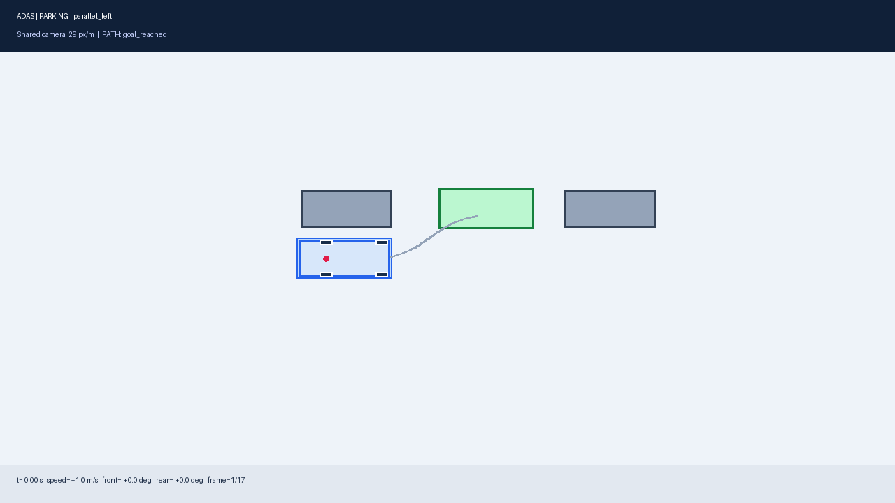 | 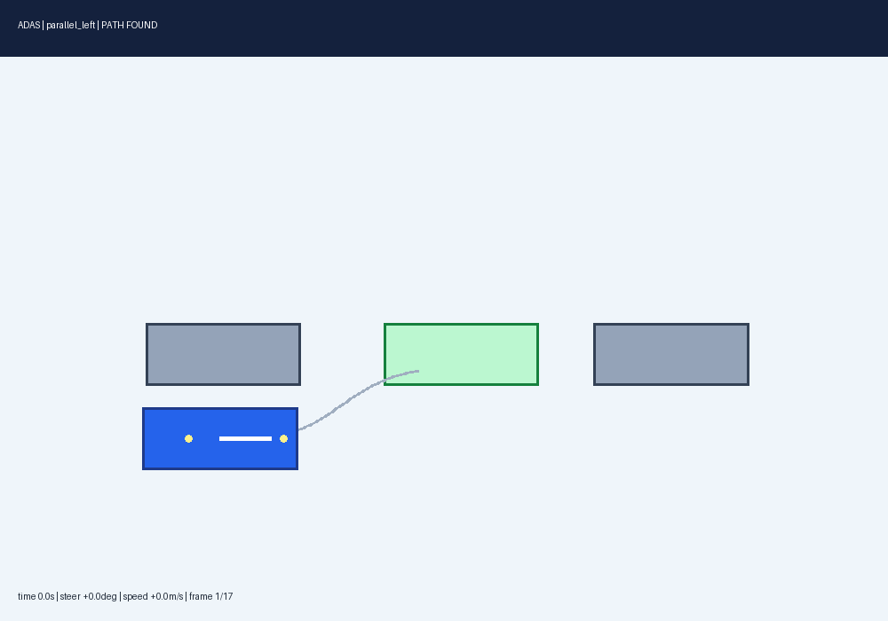 |
| Parallel right | 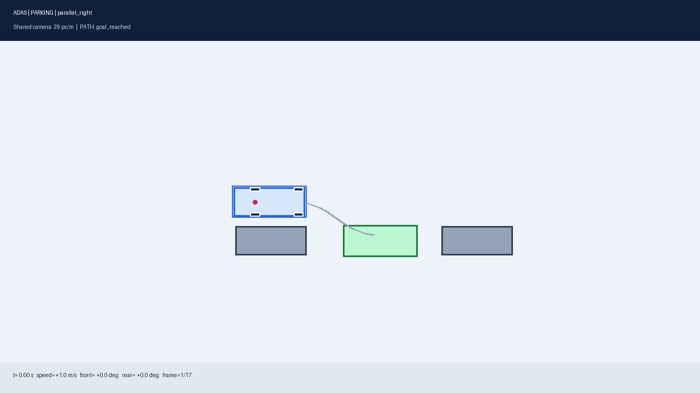 | 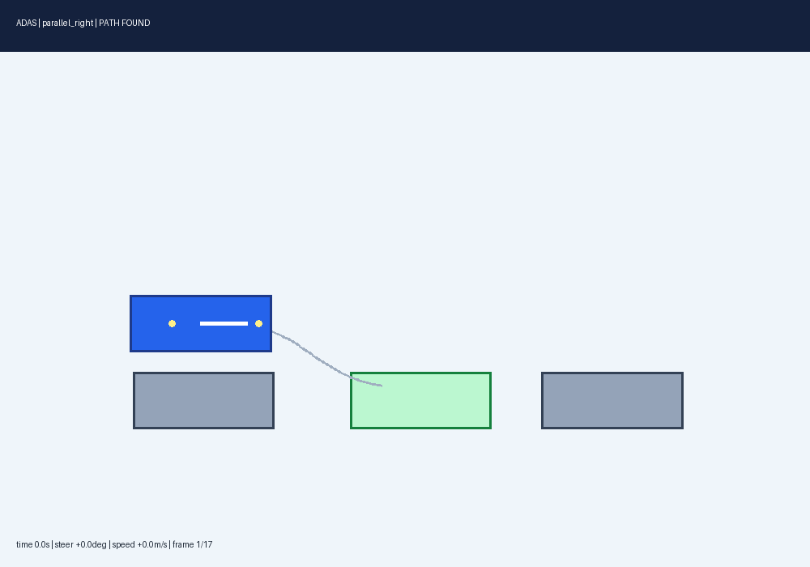 |
| Perpendicular reverse | 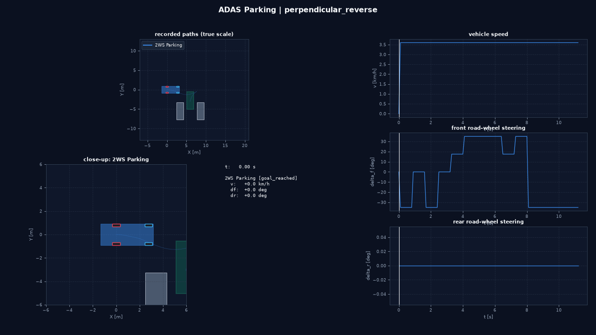 | 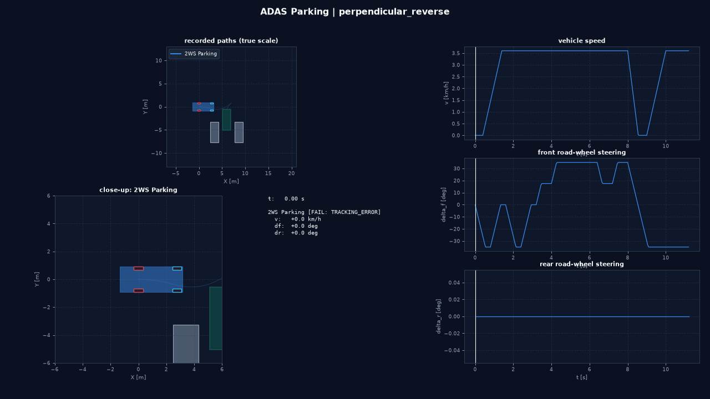 |
| Open bay | 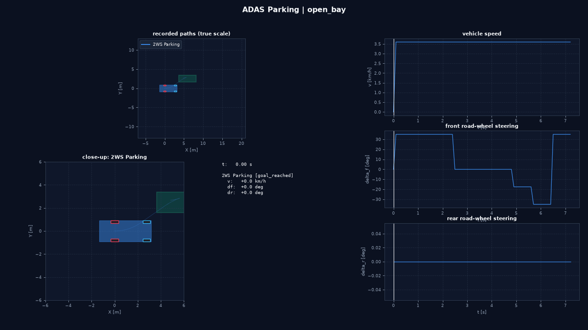 | 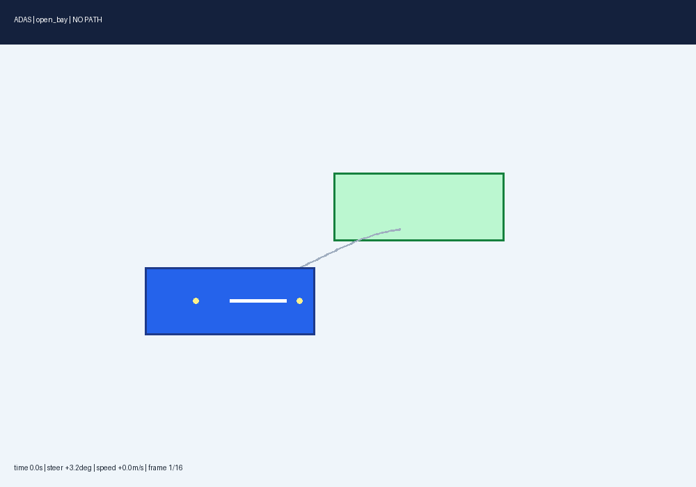 |

Generate locally: `python scripts/generate_gallery.py`. The planner GIFs show exact kinematic command replay; actuator GIFs show a **separate bounded feedforward execution** and may indicate tracking error or collision. An animated run is not proof of safe or successful parking.

### Engineering progress

- **Implemented:** Hybrid A*, seeded RRT / limited RRT* / FMT-inspired variants, sampled polygon collision checking, planner benchmarks, plan-replay GIFs, deterministic ultrasonic ray-cast and localization noise, discrete-horizon emergency-stop guard, feedforward steering rate / acceleration / gear dwell.
- **Not yet implemented:** fully constrained Reeds-Shepp connector, trajectory smoothing/optimization, closed-loop MPC, parking-space perception from raw sensor data, dynamic-obstacle replanning, live interactive GUI, validated 7-DOF Vehicle-Dynamics adapter. The optional adapter interface deliberately raises `NotImplementedError` until correctly mapped.


## Planar 2WS vs 4WS benchmark (Vehicle-Dynamics-inspired)

The 2D vehicle renderer now draws **a body polygon and four individual tire polygons**, with visible front and rear steering, actual wheelbase/track and correctly oriented rear-axle midpoint pose. At parking speed the rear axle follows a limited counter-phase steering ratio `delta_rear = -0.30 * delta_front` (maximum 10 degrees), inspired by the existing [Vehicle-Dynamics 4WS coordinator](https://github.com/CagriCatik/Vehicle-Dynamics/blob/main/src/vehicle_model/steering/four_wheel_steering.py). Both front and rear steering are rate limited.

The baseline comparison feeds **identical front-steering and speed commands** into 2WS and 4WS; the resulting final poses therefore differ. These are paired *maneuverability experiments*, not proof of identical-target autonomous parking success or a full dynamic coupling to the external 7-DOF model.

| Maneuver | 2WS vs 4WS planar animation |
| --- | --- |
| Left turn | 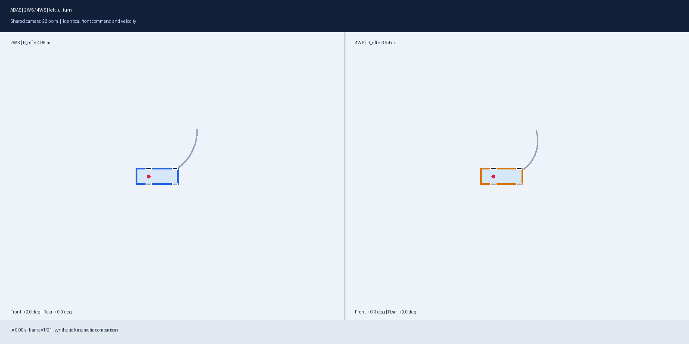 |
| Right turn | 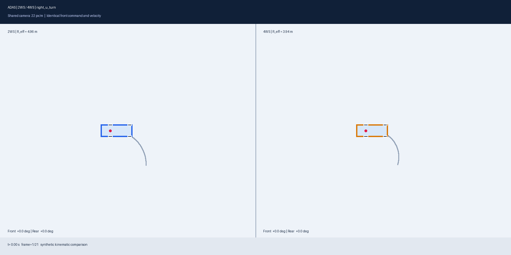 |
| Reverse arc | 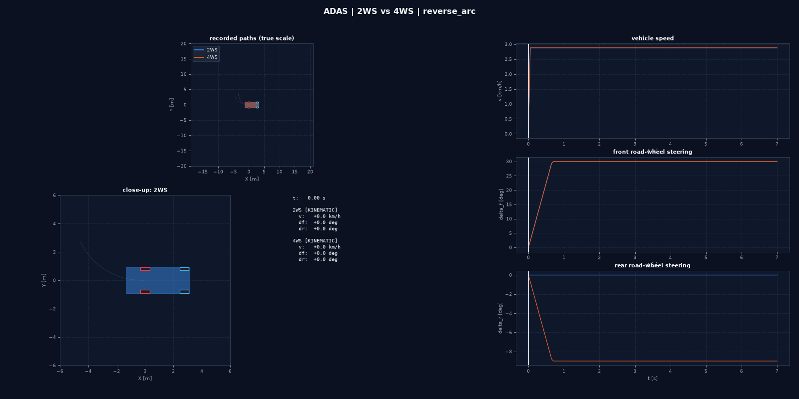 |
| Parking S-bend | 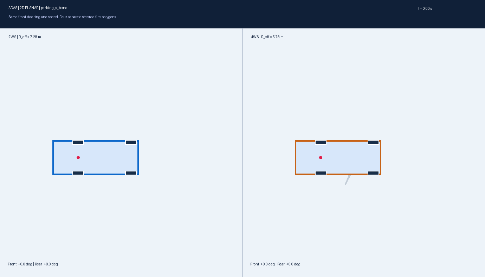 |

Run `python -m adas_sim.steering_benchmark` to generate reproducible GIFs and `results.csv`/`results.json`. `scripts/generate_gallery.py` and the GIF CI workflow commit outputs into `docs/assets/steering/`.

**Next:** replan each parking target for 2WS and 4WS separately; compare goal arrival, body swept space, clearance and gear changes under a shared collision checker. The current 4WS steering law is a low-speed kinematic adaptation, not a direct import of the Vehicle-Dynamics plant.


## Interactive V0.2 workbench and safety/plant extensions

Launch the local **2D planar parking workbench**:

```bash
python -m pip install -e ".[test]"
adas-workbench --host 127.0.0.1 --port 8766
```

Visit [http://127.0.0.1:8766](http://127.0.0.1:8766) for selectable parking scenarios, playback controls, four-wheel vehicle rendering and telemetry. This is a read-only visualization of planned kinematic paths, not a physically validated interactive driving simulator.

Additional modules:
- `trajectory.py`: collision-checked trajectory replay and gear-aware speed envelope (no full Reeds-Shepp or curvature-continuous smoother yet).
- `control.py`: steering-rate, acceleration, braking and gear-dwell-limited execution; reports tracking errors honestly.
- `sensors.py`: synthetic ultrasonic ray-casting and seeded localization noise.
- `supervisor.py`: explicit stop/replan state machine for changed obstacles and missing localization.
- `vehicle_adapter.py`: optional Vehicle-Dynamics **kinematic single-track** bridge with verified rear-axle/CoG coordinate conversion; **not** a seven-DOF adapter.

Read the [V0.2 engineering status, implementation boundaries and limitations](docs/engineering-v02.md).
