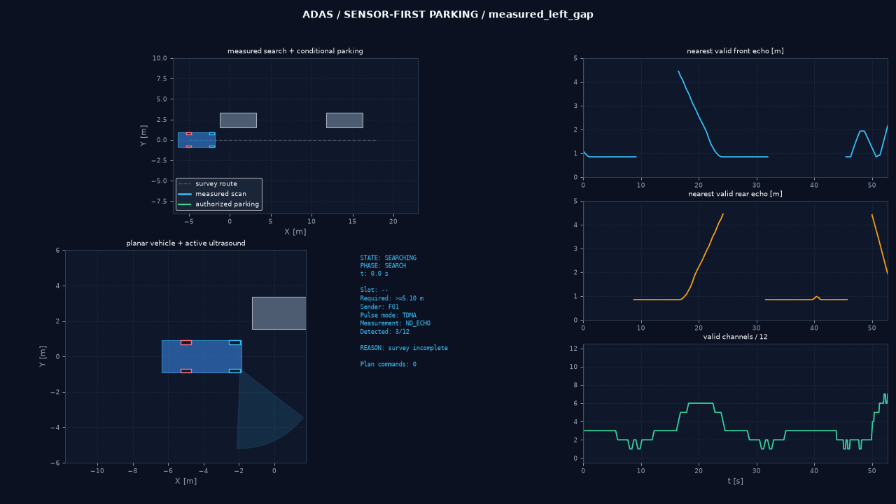
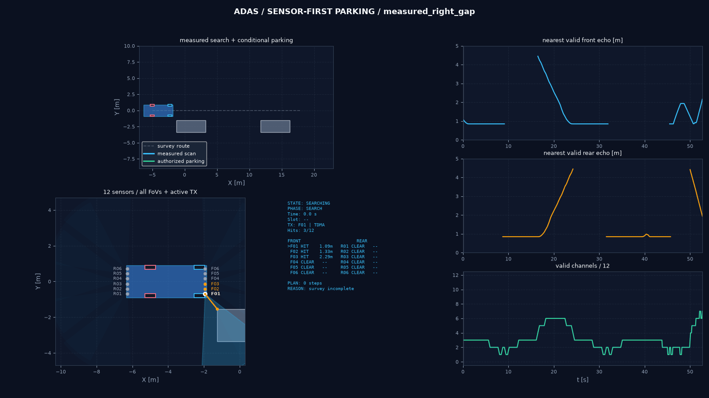
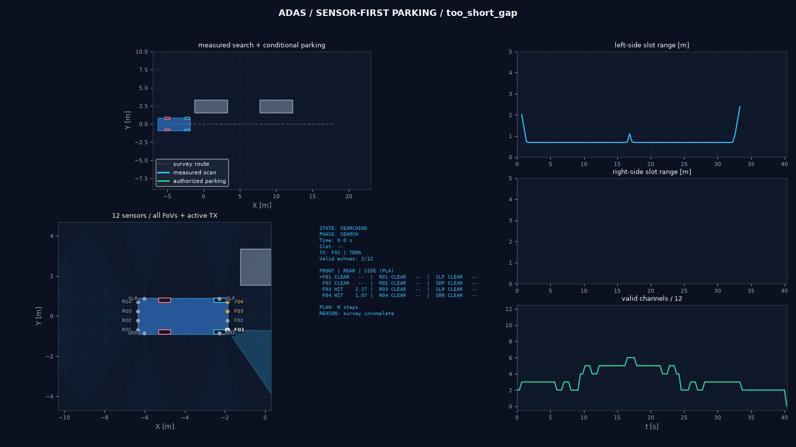
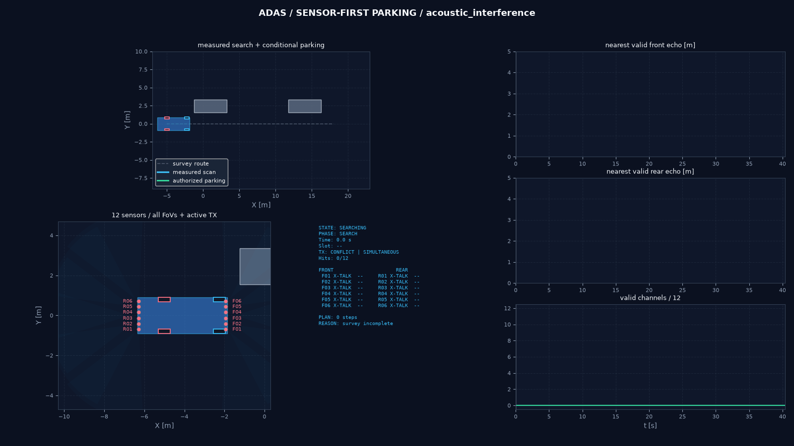

# ADAS Simulation Platform

A reproducible **autonomous parking research baseline** with deterministic low-speed Ackermann dynamics, grid-quantized Hybrid A* motion planning, oriented vehicle-body collision checks, command replay, validation metrics, and a separately validated visualization layer. Python 3.10+.

> **Simulation only.** This is not automotive safety software and has not been validated against real vehicle measurements. It is not yet a full ADAS or production autonomous parking system.

## Quick start

```bash
python -m pip install -e ".[test]"
pytest -q
adas-parking --scenario open_bay
adas-parking --scenario all
```

Results are saved in `output/parking/` as SVG and JSON trajectory/controls/summary reports. Nonzero CLI exit status denotes an unsuccessful scenario.

## Architecture

```text
src/adas_sim/
  geometry.py     Oriented vehicle footprint and SAT collision checks
  plant.py        Low-speed no-slip Ackermann kinematics
  planner.py      Deterministic Hybrid A* baseline
  scenarios.py    Parallel, perpendicular, open-bay fixtures
  validation.py   Independent replay and acceptance metrics
  svg.py          Top-down SVG renderer
  cli.py          Run scenarios and export reports
```

`Vehicle-Dynamics` remains the source of truth for detailed vehicle dynamics: [CagriCatik/Vehicle-Dynamics](https://github.com/CagriCatik/Vehicle-Dynamics). A future optional adapter will connect the two without copying the physics or changing the existing plant.

## Scope / limitations

- Park spaces and obstacles are ground truth, not perceived from sensors.
- Motion primitives enforce the steering-angle limit but not actuator-rate dynamics.
- Finite collision sampling is not a continuous-time swept-volume safety guarantee.
- No parking perception, sensor fusion, dynamic obstacle avoidance, localization or real vehicle validation.
- Next milestones: continuous swept clearance, speed/steering tracking and gear-switch dwell, Reeds-Shepp and trajectory smoothing, sensor simulation, fault injection, and browser UI.
- Add AEB, ACC and lane keeping only through isolated ADAS modules and shared interfaces.

## Reproducible development

```bash
python -m pytest -q
python -m adas_sim --scenario all
```

## Licensing

No license has been granted by the initial scaffold; confirm a license before accepting contributions or redistributing code.


## V0.2: comparison of kinodynamic parking planners

New optional CLI command:

```bash
python -m pip install -e ".[test]"
python -m pytest -q
adas-benchmark --scenario parallel_left --algorithm all --iterations 1200 --seed 42
adas-benchmark --scenario all --algorithm hybrid_astar
```

Each benchmark run saves `result.json`, `trajectory.svg`, `vehicle.gif`, plus aggregate `benchmark.csv` and `benchmark.json` under `output/benchmarks/`.

Planner names: `hybrid_astar`, `rrt`, `rrt_star`, `fmt_star`. All share the same Ackermann motion integration, rectangle SAT collision checks and independent command replay. Sampling planners are deterministic per random seed. **The FMT implementation is FMT-inspired and is not canonical FMT*.** RRT* uses conservative exact-endpoint parent selection rather than general continuous steering rewiring; neither optimality nor probabilistic completeness is established.

The GIF is a real plan replay in top-down 2D with scaled vehicle footprint, axle and heading markers, steering telemetry and time. A failed planner produces a no-path result; no replacement method is silently inserted. Parked obstacles are idealized rectangles. Steering rate, velocity ramping, sensor error and continuous swept collision checks remain future work.

For reproducible performance claims, compare success rates over multiple seeds and identical budgets; individual wall times depend on machine and are not physical driving times.


### Engineering progress

- **Implemented:** Hybrid A*, seeded RRT / limited RRT* / FMT-inspired variants, sampled polygon collision checking, planner benchmarks, plan-replay GIFs, deterministic ultrasonic ray-cast and localization noise, discrete-horizon emergency-stop guard, feedforward steering rate / acceleration / gear dwell.
- **Not yet implemented:** fully constrained Reeds-Shepp connector, trajectory smoothing/optimization, closed-loop MPC, parking-space perception from raw sensor data, dynamic-obstacle replanning, live interactive GUI, validated 7-DOF Vehicle-Dynamics adapter. The optional adapter interface deliberately raises `NotImplementedError` until correctly mapped.


## Planar 2WS vs 4WS benchmark (Vehicle-Dynamics-inspired)

The 2D vehicle renderer now draws **a body polygon and four individual tire polygons**, with visible front and rear steering, actual wheelbase/track and correctly oriented rear-axle midpoint pose. At parking speed the rear axle follows a limited counter-phase steering ratio `delta_rear = -0.30 * delta_front` (maximum 10 degrees), inspired by the existing [Vehicle-Dynamics 4WS coordinator](https://github.com/CagriCatik/Vehicle-Dynamics/blob/main/src/vehicle_model/steering/four_wheel_steering.py). Both front and rear steering are rate limited.

The baseline comparison feeds **identical front-steering and speed commands** into 2WS and 4WS; the resulting final poses therefore differ. These are paired *maneuverability experiments*, not proof of identical-target autonomous parking success or a full dynamic coupling to the external 7-DOF model.

**Next:** replan each parking target for 2WS and 4WS separately; compare goal arrival, body swept space, clearance and gear changes under a shared collision checker. The current 4WS steering law is a low-speed kinematic adaptation, not a direct import of the Vehicle-Dynamics plant.


## Interactive V0.2 workbench and safety/plant extensions

Launch the local **2D planar parking workbench**:

```bash
python -m pip install -e ".[test]"
adas-workbench --host 127.0.0.1 --port 8766
```

Visit [http://127.0.0.1:8766](http://127.0.0.1:8766) for selectable parking scenarios, playback controls, four-wheel vehicle rendering and telemetry. This is a read-only visualization of planned kinematic paths, not a physically validated interactive driving simulator.

Additional modules:
- `trajectory.py`: collision-checked trajectory replay and gear-aware speed envelope (no full Reeds-Shepp or curvature-continuous smoother yet).
- `control.py`: steering-rate, acceleration, braking and gear-dwell-limited execution; reports tracking errors honestly.
- `sensors.py`: synthetic ultrasonic ray-casting and seeded localization noise.
- `supervisor.py`: explicit stop/replan state machine for changed obstacles and missing localization.
- `vehicle_adapter.py`: optional Vehicle-Dynamics **kinematic single-track** bridge with verified rear-axle/CoG coordinate conversion; **not** a seven-DOF adapter.

Read the [V0.2 engineering status, implementation boundaries and limitations](docs/engineering-v02.md).


## Sensor-first parking: survey → classify gap → decide → plan

**Parking is no longer authorized from a predefined scenario goal.**
The 12 ultrasonic transducers acquire range observations along a straight
survey drive. `parking_perception.py` identifies occupied regions using
side-looking front/rear channels, requires two measured boundaries and repeated
NO_ECHO evidence inside the candidate, applies a conservative clearance
margin, and derives the target pose and obstacle estimates from measurements.

`sensor_driven_parking.py` only invokes Hybrid A* if the slot was verified.
If the gap is too short, only one boundary is detected, coverage is incomplete,
or acoustic interference invalidates observations, the decision is `NO_PARK`
and **no parking trajectory is generated**.

Crucially, the detector does not read the exact simulator obstacle coordinates
or synthetic `hit_x` / `hit_y` points. The simulator's true geometry is
used only to synthesize acoustic ranges and to independently validate a plan
afterwards. The planning scene receives reconstructed obstacle geometry.

### Reproducible functional outcomes

| Synthetic survey case | Expected decision | GIF + 12-channel evidence |
| --- | --- | --- |
| Bounded bay on left | `PARK_ALLOWED` |  |
| Bounded bay on right | `PARK_ALLOWED` |  |
| Insufficient gap length | `NO_PARK` |  |
| Simultaneous adjacent pulses | `NO_PARK` |  |

All four cases also have PNG snapshots and 12-channel survey CSVs under
[docs/assets/functional_parking](docs/assets/functional_parking), plus
[summary.csv](docs/assets/functional_parking/summary.csv) and
[summary.json](docs/assets/functional_parking/summary.json).

The Vehicle-Dynamics-style dark dashboard shows **survey first**. The
parking route and estimated goal appear only after sensor authorization.
The ultrasound visualization highlights **one TDMA transmitter per frame**,
avoiding the misleading appearance of 12 simultaneous overlapping beams.

Run locally:

```bash
pip install -e ".[test]"
python -m pytest -q
adas-workbench
# Or reproduce all functional GIFs and numerical decision reports:
python scripts/publish_functional_results.py
```

The interactive workbench has four selectable survey cases, including rejected
parking and interference. Its clock and scan animation are research-level:
the vehicle pose is frozen over each full 12-pulse cycle even though the
survey moves between samples.

### Acoustic quality / crosstalk

The simplified `acoustic_schedule.py` treats neighboring transmitters whose
pulse/echo windows overlap as **INTERFERENCE**. Their outputs become invalid
rather than accepted as free space. A serialized twelve-channel TDMA schedule
uses a nominal round-trip window of `2 × 4.5 m / 343 m/s` plus a guard
interval. Real OEM networks may use more sophisticated transmit groups,
coding and per-channel filtering. **Overlapping drawn fields of view alone
are not proof of real acoustic crosstalk.**

### Scope and safety limitations

The initial slot detector assumes a straight, localized survey, roughly
parallel rectangular parked cars, a nominal vehicle width/length and adequate
visibility. It is not general slot detection for arbitrary kerbs or angles.
The acoustic simulation has no multipath, reflectivity, temperature effects,
real transducer dynamics or hardware calibration. A missing echo is treated
as limited free-space evidence only when repeated, oriented observations and
both obstacle boundaries agree; it is not automatically safe.

Successful routes are still **open-loop kinematic plans**; a real vehicle
would require continuous collision envelopes, sensor fusion, localization
uncertainty, moving-object tracking, a closed-loop controller and a verified
stop/replan supervisor. These results are not certified automated parking.

### Legacy comparison assets

The earlier [validated_results](docs/assets/validated_results) are retained as
historical **preselected-target** trajectory baselines. They did not derive
the parking target from ultrasonic sensing and must not be presented as
sensor-enabled autonomous parking. The old publisher is disabled; only the
new functional decision benchmark produces primary reference results.


### 12-channel overlay V2 (hardware versus acoustic activity)

The planar dashboard and local web workbench now show **all twelve real mounting
positions at every frame**, labelled `F01`–`F06` and `R01`–`R06`.
Each channel has a faint permanent FoV and a state indicator:

- Amber: valid obstacle echo (`DETECTED`).
- Grey: valid measurement without an echo (`NO_ECHO`).
- Red: `DROPOUT` or `INTERFERENCE`; never usable as free-space evidence.
- A white border and a brighter cyan beam: the **scheduled transmitter**.
  The other eleven remain visible but are not shown as transmitting.

The HUD includes all twelve IDs, last measured distances and channel states,
not just the active channel. The web interface provides separate toggles for
**all FoVs** and **active transmitter/echo**; mounting markers always remain
visible. GIFs are rendered in the common Vehicle-Dynamics-style 1600×900
dashboard. Behavioral slot acceptance and denial logic remains owned by
`parking_perception.py` and `sensor_driven_parking.py`, not the renderer.

**Timing limitation:** Present GIF frames represent snapshots of complete
12-channel survey cycles with an illustrative scheduled transmitter highlight;
they are not individual real-time acoustic wave-propagation subframes.
TDMA collisions are flagged by the simplified `acoustic_schedule.py`, not
derived from an OEM transducer waveform model.
